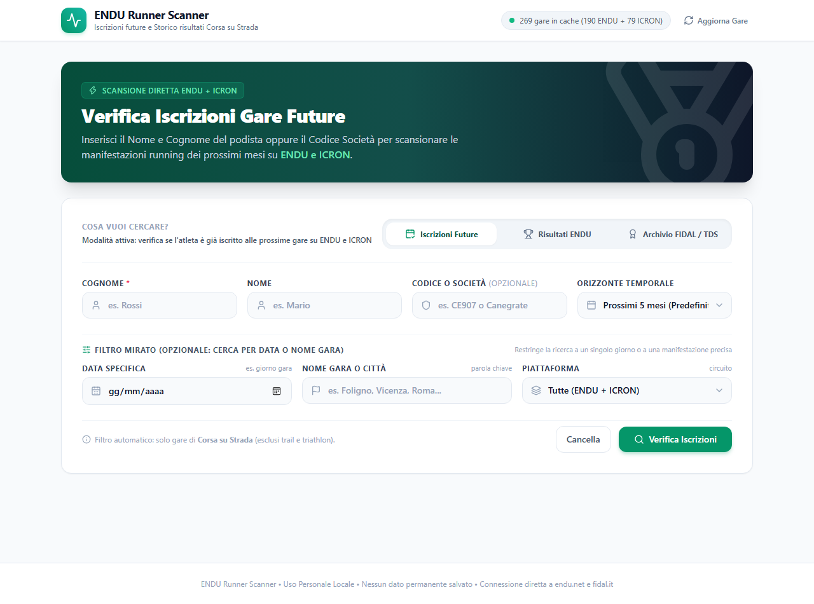

# 🏃 ENDU, ICRON & Wedosport Runner Scanner, Results & Trail Archive (v3.3)

Applicazione web locale moderna, veloce e pulita (backend Python FastAPI + frontend HTML5/Tailwind CSS) progettata per podisti, atleti e società sportive per:
1. **Verificare a quali manifestazioni future di Corsa su Strada & Trail Running** (road running, trail, skyrunning) presenti su [ENDU](https://www.endu.net), [ICRON](https://www.icron.it) e [Wedosport](https://www.wedosport.net) un atleta o una squadra risulta iscritto, con supporto a filtro unificato o per singola piattaforma.
2. **Consultare lo storico dei risultati e tempi di gara su ENDU**, con filtri mirati per data specifica e nome gara/città, con storico a ritroso fino a oltre 15 anni (dal 2010 ad oggi).
3. **Interrogare l'Archivio Carriera Ufficiale FIDAL & gare storiche TDS**, risolvendo il recupero di tutte le manifestazioni competitive certificate non presenti su ENDU (cronometrate da TDS, TDS-Live, SDAM, WinningTime, Icron), visualizzando la scheda atleta federale, la società di appartenenza e i Primati Personali (PB).
4. **Consultare la Carriera & Risultati Trail Running su Wedosport**, con accesso al palmarès completo di gare Trail, Ultra Trail, Skyrunning e Vertical dal **2004 ad oggi** (distanze, chilometri, tempi, piazzamenti e link alle classifiche ufficiali).

<p align="center">
  
</p>

---

## 🌟 Novità Versione 3.3 & Caratteristiche Principali

- **Integrazione Piattaforma Trail Running Wedosport (Novità v3.2)**:
  - Nuova scheda dedicata **Trail (Wedosport)** con archivio storico completo a partire dal **2004 ad oggi** (oltre 22 anni di manifestazioni montane).
  - Scheda gara con dettagli completi: specialità (*Trail Running, Ultra Trail, Skyrunning, Vertical*), chilometraggio esatto, tempo finale, posizione assoluta e di genere, stato della prova e collegamento diretto alla graduatoria ufficiale Wedosport.
  - Verifica automatica delle **iscrizioni future alle gare Wedosport** (parsing trasparente di `/lista-iscritti/{slug}`) sia nella ricerca combinata che con filtro dedicato.
  - Badge cromatico distintivo ambra/montagna `WEDOSPORT` per identificare immediatamente gli eventi off-road.
- **Supporto Multi-Piattaforma Unificato (ENDU + ICRON + Wedosport)**:
  - Scansione parallela automatica delle manifestazioni presenti su **ENDU** (`endu.net`), **ICRON** (`icron.it`) e **Wedosport** (`wedosport.net`).
  - Interroga direttamente gli eventi podistici ICRON (es. *iRun21 La Mezza di Vicenza*, *Due Mari Marathon*, ecc.) con supporto sia ai cognomi che ai **codici società FIDAL** (es. `vi654` convertito lato server in *Vicenza Runners*).
  - **Filtro Piattaforma a 4 Opzioni**: possibilità di selezionare *Tutte le piattaforme*, *Solo ENDU*, *Solo ICRON* oppure *Solo Wedosport (Trail)*.
- **Quattro Modalità con Schede Dedicate**:
  - **Iscrizioni Future**: Scansiona il calendario per verificare la presenza dell'atleta o della squadra su ENDU, ICRON e Wedosport.
  - **Risultati ENDU**: Cerca in quali gare su strada passate l'atleta ha tagliato il traguardo e mostra i tempi ufficiali, real-time e piazzamenti.
  - **Archivio FIDAL / TDS**: Recupera la carriera agonistica federale certificata (Mezze Maratone, 10km, Maratone) e include tutte le manifestazioni cronometrate da **TDS**, **SDAM** o **WinningTime** fin dal 2010.
  - **Trail (Wedosport)**: Consulta l'intera carriera off-road (Trail, Ultra, Skyrunning) dal 2004 ad oggi.
- **Filtro Mirato per Nome Gara o Città**:
  - Consente di restringere la scansione a una singola manifestazione o località (es. digitando `jesolo` o `vicenza` vengono scansionate solo le gare pertinenti in 1-2 secondi anziché centinaia di eventi).
- **Filtro per Data Specifica**:
  - Possibilità di inserire il giorno esatto di una gara (es. `25/05/2024`) per interrogare unicamente quell'evento.
- **Scheda Atleta Federale & Primati Personali (PB)**:
  - Nella scheda FIDAL/TDS vengono evidenziati categoria, società sportiva, anno di nascita e i record personali (PB) certificati su ogni distanza.
- **Nessun Login Richiesto**: L'accesso ai risultati digitali ufficiali e alle liste iscritti avviene in modalità pubblica on-demand.
- **Alte Prestazioni & Concorrenza Asincrona**: Chiamate parallele con `httpx` gestite da semafori `asyncio` (6-8 connessioni simultanee) per verificare centinaia di manifestazioni in pochi secondi senza bloccare l'interfaccia.
- **Barra di Avanzamento Real-Time (SSE)**: La scansione trasmette aggiornamenti in tempo reale via Server-Sent Events; ogni risultato trovato compare all'istante a schermo.
- **Caching Intelligente in Memoria RAM**: I calendari delle manifestazioni vengono memorizzati temporaneamente in memoria per evitare chiamate ripetute ai server.
- **Privacy & Assenza di Database Permanente**: Nessun dato personale memorizzato su disco; tutto opera on-demand in memoria volatile.
- **Pulsante Scorciatoia "Cerca su Strava" (Novità v3.3)**:
  - Consente di aprire con un singolo clic la ricerca atleti ufficiale di Strava in una nuova scheda del browser per seguire o verificare le attività pubbliche dei podisti.
  - **Zero scraping & 100% privacy**: l'applicazione non interroga né memorizza dati da Strava; si tratta di una semplice scorciatoia di ricerca per l'utente loggato.
  <p align="center" style="margin-top: 8px; margin-bottom: 12px;">
    
  </p>
- **Esportazione Risultati**: Pulsante rapido per copiare il riepilogo testuale formattato negli appunti con un clic.
- **Suite di Test Automatizzata**: 17 test integrati (`tests/test_api.py`) con copertura di tutti i provider e flussi di streaming.

---

## 📁 Struttura del Progetto

```text
C:\ENDU-Tool\
├── app.py                   # Entry point FastAPI e server web locale (v3.3)
├── requirements.txt         # Dipendenze Python (fastapi, uvicorn, httpx)
├── avvia_app.bat            # Script di avvio rapido con doppio clic (Windows)
├── README.md                # Documentazione tecnica e guida operativa
├── assets\
│   ├── screenshot.png       # Screenshot dell'interfaccia utente a 4 schede
│   └── strava_button.png    # Dettaglio interfaccia del pulsante di ricerca Strava
├── backend\
│   ├── __init__.py
│   ├── endu_client.py       # Motore asincrono, cache in memoria e chiamate ad ENDU
│   ├── icron_client.py      # Client asincrono e parser verifica iscritti ICRON
│   ├── wedosport_client.py  # Client asincrono, archivio carriera e iscritti Wedosport Trail
│   ├── fidal_client.py      # Client archivio atleti FIDAL, TDS e primati personali
│   └── models.py            # Schemi dati Pydantic per validazione e tipizzazione
├── frontend\
│   ├── index.html           # Interfaccia grafica reattiva a 4 schede con selettore piattaforma
│   └── static\
│       ├── app.js           # Logica client-side, gestione SSE e render delle card
│       └── style.css        # Stili e animazioni personalizzate
└── tests\
    └── test_api.py          # Suite di 17 test automatizzati (ENDU, ICRON, Wedosport, FIDAL, SSE)
```

---

## 🚀 Guida Passo-Passo per l'Installazione e l'Avvio

### ⚠️ Prerequisito su un Nuovo PC (Una tantum)
Se stai aprendo il progetto su un computer dove **Python non è ancora presente**:
1. Scarica Python dal sito ufficiale: 👉 [python.org/downloads](https://www.python.org/downloads/) (consigliato Python 3.11 o 3.12).
2. **FONDAMENTALE**: Nella primissima schermata dell'installazione, spunta la casella in basso:
   **`[X] Add python.exe to PATH`**
3. Clicca su **Install Now** e attendi il completamento.
*(Se ti dimentichi questo passaggio, `avvia_app.bat` ti guiderà automaticamente aprendoti la pagina corretta).*

---

### Metodo 1: Avvio Rapido con Doppio Clic (Consigliato su Windows)

1. Apri la cartella del progetto (es. `C:\ENDU-Tool` oppure la cartella decompressa dallo ZIP).
2. Fai **doppio clic** sul file **`avvia_app.bat`**.
3. Lo script rileverà automaticamente Python, installerà le librerie necessarie (`fastapi`, `uvicorn`, `httpx`) e aprirà direttamente il browser su:
   👉 **`http://localhost:8000`**

---

### Metodo 2: Avvio Manuale da Terminale (PowerShell o Prompt dei Comandi)

#### Passo 1: Apri il Terminale nella cartella del progetto
1. Premi il tasto `Windows + R`, digita `powershell` (o `cmd`) e premi **Invio**.
2. Spostati nella cartella del progetto digitando:
   ```powershell
   cd C:\ENDU-Tool
   ```

#### Passo 2: Installa le librerie necessarie
Digita il seguente comando e premi **Invio**:
```powershell
pip install -r requirements.txt
```
*(Le librerie richieste sono solo 3: `fastapi`, `uvicorn`, `httpx`)*.

#### Passo 3: Avvia l'applicazione
Digita il comando di avvio e premi **Invio**:
```powershell
python app.py
```

Vedrai comparire a schermo un messaggio simile a:
```text
============================================================
  🏃 ENDU, ICRON & WEDOSPORT RUNNER SCANNER (STRADA & TRAIL) 🏃
============================================================
Server locale avviato con successo!
Apri il tuo browser all'indirizzo: http://127.0.0.1:8000
Premi CTRL+C per arrestare il server.
============================================================
```

#### Passo 4: Utilizza l'applicazione nel Browser
Apri il tuo browser preferito e vai su:
👉 **`http://localhost:8000`**

---

## 🎯 Come Eseguire una Ricerca

Nell'interfaccia web puoi alternare tra quattro modalità tramite le schede in alto:

### 1. Scheda "Iscrizioni Future"
1. Inserisci il **Cognome** (obbligatorio, es. `Rossi`, `Ferrari`, `Bianchi`) e facoltativamente il **Nome** (es. `Mario`).
2. **Codice o Società (opzionale)**: per filtrare la squadra (es. `vi654` o `Vicenza Runners`) o cercare tutti gli atleti del team.
3. Seleziona l'orizzonte temporale (predefinito: **5 mesi**).
4. **Piattaforma**: seleziona se interrogare *Tutte le piattaforme*, *Solo ENDU*, *Solo ICRON* oppure *Solo Wedosport (Trail)*.
5. *(Opzionale)* Inserisci una data specifica o una parola chiave per la gara (es. `Vicenza`, `Borno`, `Foligno`).
6. Clicca su **Verifica Iscrizioni**: visualizzerai in tempo reale le manifestazioni a cui l'atleta risulta iscritto con il relativo pettorale assegnato e il badge della piattaforma.

### 2. Scheda "Risultati ENDU"
1. Inserisci il **Cognome** e/o il **Nome** del podista.
2. Seleziona l'intervallo storico desiderato (es. *Ultimi 12 mesi*, *Ultimi 24 mesi*, o qualsiasi anno dal *2010* al *2026*).
3. *(Opzionale ma consigliato)* Inserisci il **Nome Gara o Città** (es. `Jesolo`) per limitare la scansione ai soli eventi pertinenti e ottenere i risultati all'istante.
4. Clicca su **Cerca Risultati ENDU**: visualizzerai tutte le gare concluse dall'atleta con tempi ufficiali, real time, posizioni assolute, di genere e di categoria, e link alle classifiche ufficiali.

### 3. Scheda "Archivio FIDAL / TDS"
1. Inserisci il **Cognome** (es. `Rossi`) e facoltativamente il **Nome** (es. `Mario`).
2. *(Opzionale)* Filtra per anno solare o per città/gara.
3. Clicca su **Cerca Carriera FIDAL**:
   - Visualizzerai la **scheda ufficiale dell'atleta** con data di nascita, categoria e società di tesseramento.
   - Il box **Primati Personali (PB)** certificati su 10km, Maratonina, Maratona.
   - L'elenco cronologico di tutte le gare ufficiali disputate, incluse le gare cronometrate da **TDS** (come le storiche mezze maratone di Vicenza o Cittadella).

### 4. Scheda "Trail (Wedosport)" (Novità v3.2)
1. Inserisci il **Cognome** (es. `Rossi`) e facoltativamente il **Nome** (es. `Mario`).
2. *(Opzionale)* Filtra per anno specifico dal 2004 ad oggi.
3. Clicca su **Cerca Trail Wedosport**:
   - Visualizzerai l'elenco cronologico di tutte le gare di **Trail Running, Ultra Trail, Skyrunning e Vertical** disputate.
   - Badge con chilometraggio (`Km`), tempo impiegato, posizione assoluta e di genere, stato della gara e link diretto alla classifica ufficiale Wedosport.

---

## 🛡️ Note Tecniche sulle Sorgenti Dati

- **API Calendario Eventi ENDU**:
  `GET https://www.endu.net/api/events?dateFrom={start}&dateTo={end}&discipline=road_running&pageSize=500&sort=date.from`
- **API Iscritti ENDU**:
  `GET https://www.endu.net/api/editions/{event_id}/entrants?firstName=...&lastName=...&teamCode=...`
- **API Risultati ENDU**:
  - Settings gara: `GET https://www.endu.net/api/results/events/{event_id}/settings`
  - Risultati atleti: `GET https://www.endu.net/api/results?editionId={edition_id}&raceId={race_id}&categoryId={cat_id}&optionId={opt_id}&searchText={search_text}`
- **API Manifestazioni & Iscritti ICRON**:
  - Calendario manifestazioni: `POST https://www.icron.it/IcronNewGO/getOpenEvents` (filtrato per disciplina running e road racing).
  - Verifica iscritti per atleta o codice società: `POST https://www.icron.it/IcronNewGO/getIscrizioni` con parametro `criterio` (`squadra:{code}` o `cognome:{last}`), garantendo accesso trasparente senza autenticazione anche su gare con elenco generale non aperto.
- **Web Service Archivio & Iscritti Wedosport**:
  - Ricerca atleti e ID anagrafico: `POST https://www.wedosport.net/ricerca_gare.cfm`
  - Carriera agonistica Trail dal 2004: `POST https://www.wedosport.net/ricerca_atleta_dettaglio.cfm`
  - Calendario manifestazioni aperte: `GET https://www.wedosport.net/iscrizioni.cfm`
  - Verifica iscritti per singola gara: `GET https://www.wedosport.net/lista-iscritti/{slug}` con parsing dinamico delle colonne della tabella pubblica.
- **Archivio Federale FIDAL & TDS**:
  - Ricerca anagrafica: `POST https://www.fidal.it/result.php` con parametro `cerca`
  - Estrazione profilo e graduatorie: analisi diretta asincrona della scheda atleta ufficiale `https://www.fidal.it/atleta/{slug}/{hash}` senza dipendenze esterne pesanti.
- **Gestione Concorrenza & Rate Limit Polite**: Semafori asincroni controllati con `httpx` (`asyncio.Semaphore(8)` per ENDU/ICRON, `(6)` per Wedosport) per garantire massima reattività nel pieno rispetto dei server remoti.

---

## ⚖️ Conformità Legale, Tutela Privacy (GDPR) e Condizioni d'Uso

Questo software è stato sviluppato con la massima cura dal punto di vista tecnico e giuridico, prestando particolare attenzione alla disciplina sulla protezione dei dati personali e alla tutela dei servizi terzi:

1. **Finalità Esclusivamente Personale e Domestica (Esenzione GDPR Art. 2, par. 2, lett. c Reg. UE 2016/679)**:
   - Ai sensi dell'**Articolo 2, paragrafo 2, lettera c del Regolamento Generale sulla Protezione dei Dati (GDPR - Regolamento UE 2016/679)**, il presente software è progettato e concesso per l'utilizzo da parte di persone fisiche per l'esercizio di **attività a carattere esclusivamente personale o domestico** (es. verifica delle proprie iscrizioni agonistiche, supporto personale ai compagni della propria associazione sportiva, consultazione del proprio palmarès sportivo).
   - È espressamente vietato l'impiego del software per attività commerciali sistematiche, profilazione di massa a fini di marketing o rivendita a terzi di elenchi e anagrafiche.

2. **Privacy by Design e Totale Assenza di Database Persistenti**:
   - L'applicazione opera secondo i principi di minimizzazione e *privacy by design*: **non include alcun database** (né SQLite, né MySQL, né PostgreSQL, né file di memorizzazione su disco).
   - Nessun dato personale o risultato sportivo viene salvato o archiviato in modo permanente sul dispositivo locale né trasmesso a server esterni di terze parti.
   - Le informazioni consultate transitano unicamente nella memoria volatile (RAM) per il tempo strettamente necessario a comporre la visualizzazione a video ed evaporano alla chiusura del processo o allo scadere della cache tecnica (TTL 1 ora).

3. **Accesso Trasparente a sole Risorse di Pubblico Dominio (No Bypassing di Protezioni)**:
   - Tutte le richieste effettuate alle piattaforme ([ENDU](https://www.endu.net), [ICRON](https://www.icron.it), [Wedosport](https://www.wedosport.net), [FIDAL](https://www.fidal.it)) interrogano pagine web, form di ricerca e sezioni rese **pubblicamente consultabili su Internet** dagli organizzatori delle manifestazioni e dai gestori dei siti web, destinate alla libera consultazione degli elenchi iscritti e delle classifiche ufficiali da parte di atleti, cronisti e appassionati.
   - Il software **NON esegue alcun bypass di credenziali di login**, non forza aree riservate protette da password, non elude meccanismi di verifica CAPTCHA, non viola token crittografici né accede a dati sensibili o coperti da segreto.

4. **Fair Use, Rispetto dell'Infrastruttura di Rete e Rate Limiting Polite**:
   - L'applicazione implementa semafori asincroni controllati a bassa concorrenza (massimo 6-8 richieste simultanee) e sistemi di caching in memoria RAM per i calendari gare. In questo modo si evitano interrogazioni ridondanti e si garantisce un utilizzo responsabile che non reca alcun pregiudizio, rallentamento o rischio di sovraccarico (Denial of Service) all'infrastruttura dei servizi ospitanti.

5. **Tutela dei Marchi e Clausola di Non-Affiliazione**:
   - I marchi, denominazioni commerciali, loghi e grafiche di **ENDU** (Engagigo S.r.l. / Evodata S.r.l.), **ICRON** (Next Race S.r.l. / Icron), **Wedosport** (Wedosport S.r.l.), **FIDAL** (Federazione Italiana di Atletica Leggera) e dei servizi di cronometraggio menzionati (**TDS**, **SDAM**, **WinningTime**) appartengono ai rispettivi legittimi titolari.
   - Il presente software è un progetto open-source del tutto indipendente e non intrattiene alcun rapporto di affiliazione, partnership, sponsorizzazione o approvazione formale con le aziende e gli enti sopracitati. I nomi sono utilizzati esclusivamente con finalità descrittiva e referenziale per indicare la fonte pubblica dei dati sportivi consultati.

6. **Funzionalità "Cerca su Strava": Sola Ricerca Esterna, Zero Profilazione e Requisito di Login**:
   - **Nessuna associazione automatica**: Il pulsante *"Cerca su Strava"* rappresenta una semplice scorciatoia di navigazione (deep link) che apre il motore di ricerca di Strava in una nuova scheda pre-impostando il nome e cognome (`https://www.strava.com/athletes/search?text=...`). **Non associa in alcun modo automaticamente o in maniera univoca l'atleta a uno specifico profilo Strava**.
   - **Valutazione e scelta dell'utente (Gestione Omonimie)**: Data la presenza di omonimie nel mondo dello sport, è unicamente l'utente che – tra i risultati generici restituiti da Strava – valuta e sceglie se e quale atleta consultare o seguire.
   - **Requisito di Autenticazione (Login Attivo su Strava)**: La funzione di ricerca interna di Strava è un servizio protetto di Strava Inc. Essa produce risultati ed è consultabile **esclusivamente se l'utente è già loggato con il proprio account personale su Strava nel browser**. Se l'utente non ha effettuato il login, Strava non mostra alcun dato personale, attività GPS o profilo sportivo.
   - **Zero Scraping, Zero Chiamate Backend e Nessun Trattamento Dati**: L'applicazione non esegue alcuno scraping o richiesta automatica verso Strava, non preleva né memorizza dati di allenamento, frequenze cardiache o tracce GPS e non interagisce con le API di Strava. La privacy e le impostazioni di visibilità degli atleti rimangono gestite al 100% dalla piattaforma Strava nel pieno rispetto del GDPR (Reg. UE 2016/679).

7. **Licenza Open-Source e Limitazione di Responsabilità**:
   - Il software viene fornito "così com'è" (*as is*), senza garanzie esplicite o implicite, sotto licenza open-source [MIT](LICENSE). L'utente finale è l'unico responsabile dell'utilizzo del software in conformità alle leggi vigenti e ai termini d'uso dei portali liberamente consultati.

---

## 👤 Autore & Licenza

- **Autore**: [@dnyrulez78](https://github.com/dnyrulez78)
- **Licenza**: Distribuito sotto licenza open-source [MIT](LICENSE). Sei libero di utilizzare, modificare e distribuire questo software citandone la paternità.
